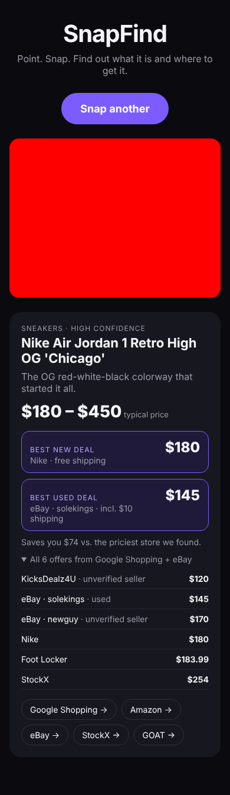

# SnapFind

Point your camera at anything (sneakers, a car, a plant, an outfit) and find out what it is, what it costs, and where to buy it.



New to the code? Start with **[LEARN.md](LEARN.md)**, which explains every file in plain English.

## Run it on your computer

1. Install [Node.js](https://nodejs.org) (version 20 or newer).
2. Get an Anthropic API key at [console.anthropic.com](https://console.anthropic.com).
3. In this folder, run:

   ```bash
   npm install
   cp .env.example .env.local   # then open .env.local and paste your key
   npm run dev
   ```

4. Open http://localhost:3000 and snap something.

### Live prices (optional)

Without these keys the app still works, it just shows store links instead of live prices. Add them to `.env.local`:

- `SERPAPI_KEY`: Google Shopping results, from [serpapi.com](https://serpapi.com) (free tier available)
- `EBAY_CLIENT_ID` and `EBAY_CLIENT_SECRET`: from [developer.ebay.com](https://developer.ebay.com) (free)

Run the tests with `npm test`.

## Roadmap

- [x] **Week 1:** snap, identify with AI, estimated price, store links
- [x] **Week 2:** live prices from Google Shopping and eBay, best new and used deal picker
- [ ] **Week 3:** our own image search index for instant repeat lookups, history, share cards
- [ ] **Weeks 4–5:** affiliate links, analytics, launch
